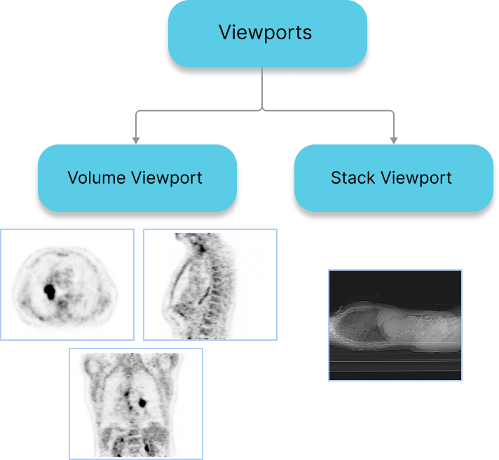

# Viewports

A viewport can be thought of as:

- A camera viewing an image from a specific perspective.
- A canvas to display the output of this camera.
- A set of transforms from the image data to viewable data (LUT, Window Level, Pan etc)

In `Cornerstone3D` viewports are created from HTML elements, and the consumer should
pass the `element` for which the viewport should be created. For example, a CT series can be
viewed via 4 viewports in a “4-up” view: Axial MPR, Sagittal MPR, Coronal MPR, A 3D perspective volume render.

See [Viewport Reference and Framing](./viewportReferencePresentation.md) for more details on the reference
and the framing that select which image and how that image is presented.

Every viewport uses a semantic `ViewState` as its mutation source of truth. Code that needs cross-viewport pan, zoom, rotation,
scale, or renderer-camera output should use
[`Viewport Projection`](./generic-viewport/viewport-projection.md) instead of
copying camera objects between viewport families.

<div style={{textAlign: 'center'}}>



</div>

## Planar viewport

`PlanarViewport`, made with `ViewportType.PLANAR`. One class shows a stack of
images or a slice of a volume. What it shows decides how it behaves, and
`viewport.getCurrentMode()` says `'stack'`, `'volume'` or `'empty'`.

- **Stack mode**: a display set registered without a `volumeId`. Suitable for
  rendering a stack of images, that might or might not belong to the same
  series. A stack can include 2D images of various shapes, sizes and
  directions, and shows in its acquisition plane.
- **Volume mode**: a display set registered with a `volumeId`. Suitable for
  rendering a volumetric data which is considered as one 3D image. It enables
  Multi-planar reformation or reconstruction (MPR) by design, in which you can
  visualize the volume from various different orientations without addition
  of performance costs. It is also the mode for image fusion between two
  series: the first display set is the source, the others are overlays.

## 3D Viewport

`VolumeViewport3D`, made with `ViewportType.VOLUME_3D`.

- Suitable for actual 3D rendering of a volumetric data.
- For having different types of presets such as Bone, Soft Tissue, Lung, etc.,
  as the `preset` key of the appearance.
- A surface is a geometry display set of a 3D viewport.

:::note

Every viewport is created via the `RenderingEngine` API.

:::

## Video Viewport

`VideoViewport`, made with `ViewportType.VIDEO`.

- Suitable for rendering video data
- Video can include MPEG 4 encoded vide streams. In theory, MPEG2 is also supported,
  but practically the browser doesn't support that.

## Whole Slide Image Viewport

`WSIViewport`, made with `ViewportType.WHOLE_SLIDE`.

- Suitable for rendering whole slide images

## ECG Viewport

`ECGViewport`, made with `ViewportType.ECG`.

- Suitable for rendering the waveform of an ECG, in a trace layout

## Initial Display Area

A planar viewport takes a display area as the key `displayArea` of its view
state: `viewport.setViewState({ displayArea })`. It can be used to programmatically set
the zoom and pan on an image. By default, the viewport will fit the dicom image to
the screen. A display area in the options of a viewport (`defaultOptions.displayArea`)
is the first one of its view state, and with `storeAsInitialCamera: true` it is the
one that `resetViewState()` shows. The `displayArea` takes a `DisplayArea` type which
has the following fields.

```js
type DisplayArea = {
  imageArea: [number, number], // areaX, areaY
  imageCanvasPoint: {
    imagePoint: [number, number], // imageX, imageY
    canvasPoint: [number, number], // canvasX, canvasY
  },
};
```

Zoom and pan are all relative to the initial "fit to screen" view.

In order to zoom into the image 200%, we would set the `imageArea` to [0.5, 0.5].

Panning is controlled by a provided `imagePoint` and a provided `canvasPoint`. You can imagine the canvas as a sheet of white paper and the image as another sheet of paper like a chest x-ray. Mark a point in the canvas paper with a pen and then mark another point on your chest x-ray image. Now try to "pan" your image so the point so the `imagePoint` matches the
`canvasPoint`. This is what the API design of `imageCanvasPoint` represents.

Thus if you wanted to left align you image, you could provide the following value:

```js
imageCanvasPoint: {
  imagePoint: [0, 0.5], // imageX, imageY
  canvasPoint: [0, 0.5], // canvasX, canvasY
};
```

This means the left (0) middle (0.5) point on the canvas needs to align with the
left (0) middle (0.5) point on the image. Values are based on % size of the full image.
In this example, if we had a 1024 x 1024 x-ray image. The imagePoint would be [0, 512].
Let's say we were on a mobile iPhone in landscape mode (844 x 390). The canvasPoint would be [0, 195].
