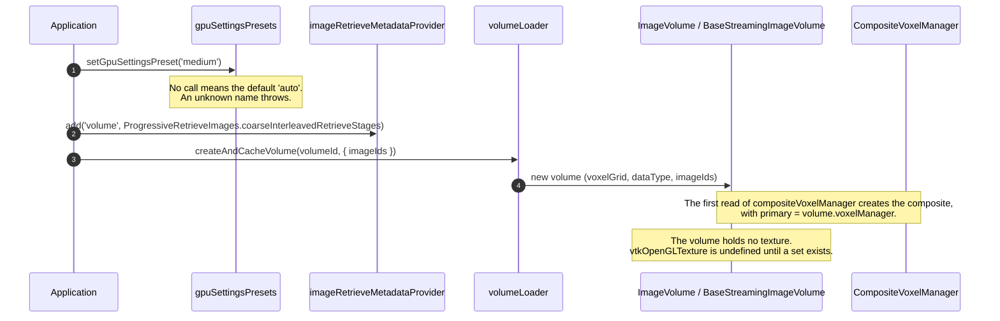
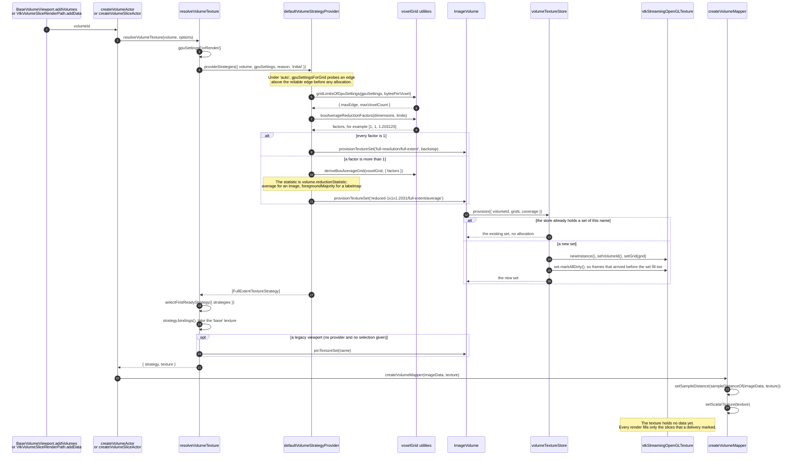
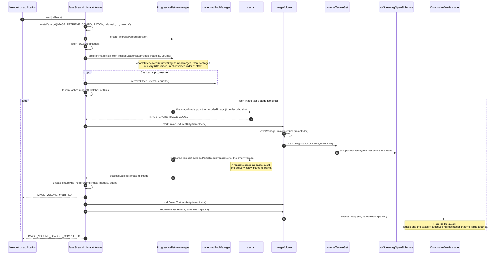
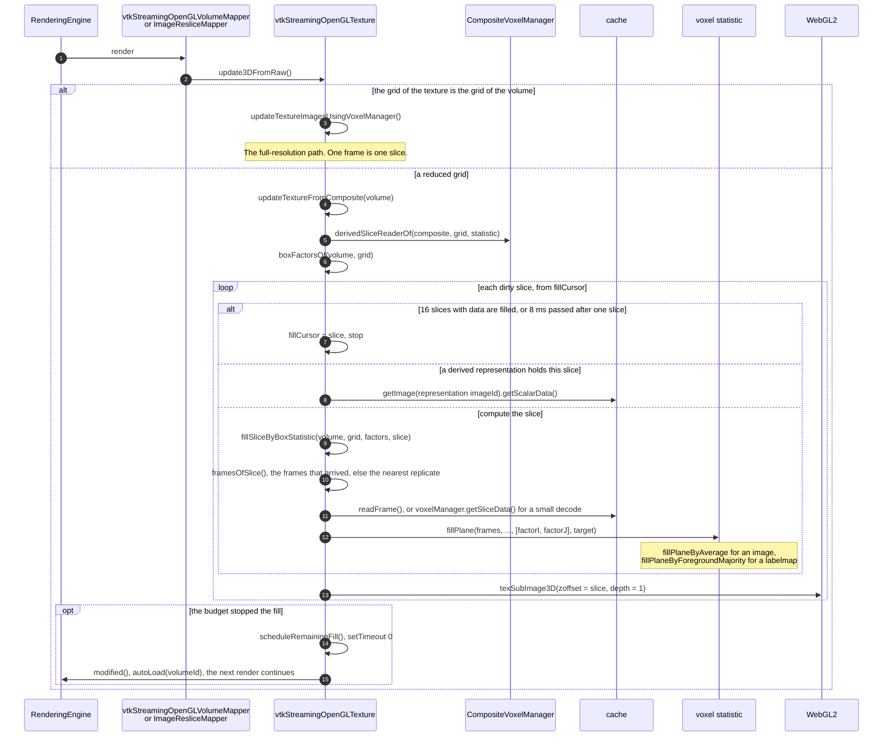
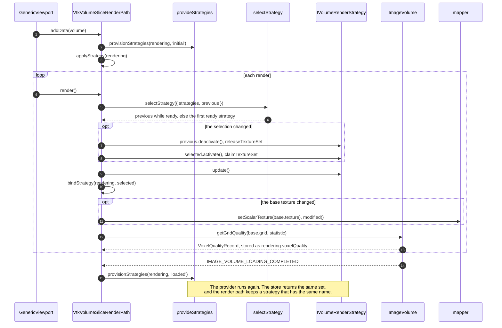
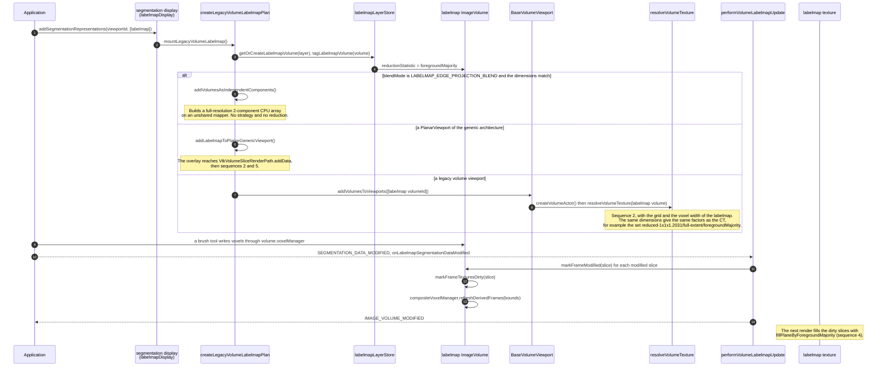

# Volume Render Sequences

This page gives the sequence of calls for the multi-resolution volume work. Each diagram names the
real functions and files. [Volume Render Strategy](./volumeRenderStrategy.md) gives the design, and
[Composite Voxel Manager](./compositeVoxelManager.md) gives the model of the voxels. Read those two
pages for the reasons. Read this page to find the code.

The diagrams use Mermaid. GitHub shows a diagram in the view of a file and in a pull request.

The six sequences are:

1. [The application selects the GPU settings and creates the volume](#1-the-application-selects-the-gpu-settings-and-creates-the-volume)
2. [A viewport adds its actor, and the provider chooses the texture](#2-a-viewport-adds-its-actor-and-the-provider-chooses-the-texture)
3. [The loader delivers the images](#3-the-loader-delivers-the-images)
4. [A render fills the dirty slices of a reduced texture](#4-a-render-fills-the-dirty-slices-of-a-reduced-texture)
5. [A render path of the generic architecture selects a strategy on each render](#5-a-render-path-of-the-generic-architecture-selects-a-strategy-on-each-render)
6. [A segmentation is displayed over a reduced volume](#6-a-segmentation-is-displayed-over-a-reduced-volume)

## A worked example

A CT series of 512 × 512 × 2464 voxels gives these results. The edge limit decides each factor here,
because the memory of each preset is larger than the reduced texture.

| Preset              | `maxTextureEdge` | Factors (i, j, k) | Texture grid     | Texture set                              |
| ------------------- | ---------------- | ----------------- | ---------------- | ---------------------------------------- |
| `high-texture-4096` | 4096             | 1, 1, 1           | 512 × 512 × 2464 | `full-resolution/full-extent`            |
| `high`, `medium`    | 2048             | 1, 1, 1.203125    | 512 × 512 × 2048 | `reduced-1x1x1.2031/full-extent/average` |
| `low`, `low-tablet` | 256              | 2, 2, 9.625       | 256 × 256 × 256  | `reduced-2x2x9.625/full-extent/average`  |

Under `auto`, the result depends on the device. A device with a `MAX_3D_TEXTURE_SIZE` of 2048 gives
the row of `high`. A device that passes the probe at 2464 gives the row of `high-texture-4096`.

`boxAverageReductionFactors` sets each reduced edge M to `min(dimension, maxTextureEdge)`. Then,
while the reduced grid holds more voxels than `textureMemoryBytes / bytesPerVoxel`, it takes one
voxel from the largest reduced axis. Last, an axis takes a whole factor f that divides its edge when
`dimension / f` is at least 0.9 of M. The factor is `dimension / M`, so 2464 / 256 gives 9.625: no
divisor of 2464 gives an edge between 231 and 256. Each texel covers its exact range of the source,
see `VRS-I-18` in [Volume Render Strategy](./volumeRenderStrategy.md).

## 1. The application selects the GPU settings and creates the volume

Without final downsampling (`rendering.lossyDownsampling.final`), a volume gets its full-resolution
texture. With it, the default preset is `auto`, which reads the stored record of the device. An
application that selects a named preset does so before a viewport adds its actor. A viewport reads
the preset only at that moment.

## 2. A viewport adds its actor, and the provider chooses the texture

Both architectures meet in `resolveVolumeTexture`. A legacy viewport (`BaseVolumeViewport`,
`VolumeViewport3D`) calls it through `createVolumeActor`. A render path of the generic architecture
calls it through `createVolumeSliceActor` or `createVolumeActor`, with its own provider and
selection.

A slice actor calls `mapper.setScalarTexture` in `createVolumeSliceActor` and samples no ray, so it
has no sample distance.

## 3. The loader delivers the images

A delivery marks slices and records quality. A delivery uploads nothing. The load can start before
or after the actor exists: a set that the provider creates later marks all of its slices dirty.

`markFrameModified` is the third entry point. An edit at an unchanged quality calls it. Sequence 6
shows it.

## 4. A render fills the dirty slices of a reduced texture

The fill runs on the main thread inside the render. A budget limits each render, and the texture
asks for another render for the slices that remain.

`rendering.reducedTextureFill.maxSlicesPerRender` (16) and
`rendering.reducedTextureFill.maxMillisecondsPerRender` (8) set the budget.

## 5. A render path of the generic architecture selects a strategy on each render

A legacy viewport stops after sequence 2: it keeps the texture that `resolveVolumeTexture` gave.
A render path of the generic architecture holds its strategies, and it selects again on each render.

`VtkVolume3DRenderPath` follows the same steps. It also sets the sample distance again when it binds
a texture of another grid.

## 6. A segmentation is displayed over a reduced volume

A labelmap is a volume of its own, with its own texture set. The labelmap reduces by foreground
majority, so each reduced voxel holds a real segment index.

The CT and the labelmap stay aligned because `deriveBoxAverageGrid` puts the offset of the box
centre in the origin of the reduced grid. Two volumes with the same grid and the same factors get the
same reduced grid.

A tool reads `volume.voxelManager`, which is the full-resolution primary representation. A
measurement and a brush therefore never read a reduced texture.
