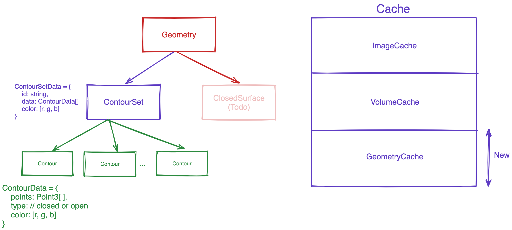

# Contour Segmentation Representation

A Contour Segmentation Representation is a collection of Contour Sets. Each Contour Set is a collection of Contours. Each Contour is a collection of Points. Each Point is a collection of 3D coordinates.



## Contour Set

Since usually a segmentation is a collection of multiple structures, each Contour Set represents a single structure. For example, a segmentation can have multiple Contour Sets, each representing a different structure. Each Contour Set has a unique ID, and a name. The name is used to display the structure name in the UI.

## Contour

A Contour includes the information about the points that make up the contour. Each Contour has data, type (closed or open), and a color.

## Loading Contour as Segmentation Representation

```js
// load each contour set and cache the geometry
const promises = contourSets.map((contourSet) => {
  return geometryLoader.createAndCacheGeometry(contourSet.id, {
    type: GeometryType.CONTOUR,
    geometryData: contourSet as Types.PublicContourSetData,
  });
});

await Promise.all(promises);

// Add the segmentations to state
segmentation.addSegmentations([
  {
    segmentationId,
    representation: {
      // The type of segmentation
      type: csToolsEnums.SegmentationRepresentations.Contour,
      // The actual segmentation data, in the case of contour geometry
      // this is a reference to the geometry data
      data: {
        geometryIds: contourSets.map((contourSet) => contourSet.id),
      },
    },
  },
]);

// Add contour representation to a specific viewport
await segmentation.addContourRepresentationToViewport(viewportId, [
  {
    segmentationId,
    type: Enums.SegmentationRepresentations.Contour,
  },
]);

```

## Contours on a viewport of another plane

A contour set usually lies in one plane orientation, as the axial contours of
an RTSTRUCT. A planar viewport of that orientation draws the contours as they
are. A planar viewport of another plane (the sagittal or coronal pane of an
MPR, an oblique plane, a stack whose images lie in another plane) draws the cut
of each structure by the slice on display: the contours of the structure are
made into a surface once, the surface is cut by every slice of the viewport in
a web worker, and a scroll shows the cut of the next slice. Each structure is
cut and shown as soon as its surface is made, the structures on the slice on
display and the small ones first, so the viewport fills in structure by
structure. The viewport cuts again when its plane changes and when the
contours change.

This needs the polySeg add-on, which converts in one web worker by default.
More workers finish a large set sooner but each holds more memory; `init` of
the add-on sets the number before its first conversion:

```js
import * as polySeg from '@cornerstonejs/polymorphic-segmentation';

polySeg.init({ maxWorkerInstances: 2 });
cornerstoneTools.init({ addons: { polySeg } });
```

Measured on an RTSTRUCT of 31 structures (2,265 contours) shown in the
sagittal and coronal panes of an MPR, in Chrome on a recent Mac, from the
moment the representation is added:

| Workers | First cut shown | Last cut shown | Memory at the peak (browser total) |
| ------- | --------------- | -------------- | ---------------------------------- |
| 1       | 1.8 s           | 16 s           | 2.2 GB                             |
| 2       | 1.8 to 3 s      | 12 to 13 s     | 2.6 GB                             |
| 4       | 2 s             | 11 to 12 s     | 3.2 GB                             |

The largest structure alone takes 7 s, so more than two workers gain little
there. A worker is started at the first conversion that needs it and stops
after 2 s without one.

A structure whose contours lie on planes that are not parallel, or whose
conversion to a surface fails, is not cut, and a warning names the
segmentation, the structure and the reason.

## Knowing when the cuts are drawn

The cuts of a viewport come over seconds, structure by structure, so a test
that takes a picture or an application that shows progress waits for them by
their state, not by a time:

- `segmentation.getContourCutsState(viewportId, segmentationId)` gives
  `'pending'` while the viewport has the Contour representation of the
  segmentation and the cut of its plane for the current contours is not all
  drawn (the representation has not rendered on it yet, its plane changed
  and waits to settle, or a conversion or a cut runs), and `'complete'`
  otherwise.
- `Enums.Events.SEGMENTATION_CONTOUR_CUTS_COMPLETED` fires on the
  `eventTarget` once per viewport and segmentation each time the state
  becomes complete: after the first conversion, and again after a change of
  the contours or of the plane once the new cuts are drawn. The contours of
  the slice on display are drawn when it fires. Its detail has `viewportId`,
  `segmentationId`, `segmentIndices` (the structures that are cut) and
  `failedSegmentIndices` (the structures that are not cut, each reported in
  the log with its reason).

A scroll needs no new cut, as every slice of the plane is cut at once: the
state stays complete and nothing fires. A viewport in the plane of the
contours needs no cut: its state is complete as soon as the representation
has rendered on it, and the event fires once then, with no structure. A
segmentation whose contours are not contour sets (`geometryIds`) is not cut,
so its state is complete.

```js
async function waitForContourCuts(viewportId, segmentationId) {
  if (
    segmentation.getContourCutsState(viewportId, segmentationId) === 'complete'
  ) {
    return;
  }

  await new Promise((resolve) => {
    const onCompleted = ({ detail }) => {
      if (
        detail.viewportId === viewportId &&
        detail.segmentationId === segmentationId
      ) {
        eventTarget.removeEventListener(
          Enums.Events.SEGMENTATION_CONTOUR_CUTS_COMPLETED,
          onCompleted
        );
        resolve(detail);
      }
    };

    eventTarget.addEventListener(
      Enums.Events.SEGMENTATION_CONTOUR_CUTS_COMPLETED,
      onCompleted
    );
  });
}
```
