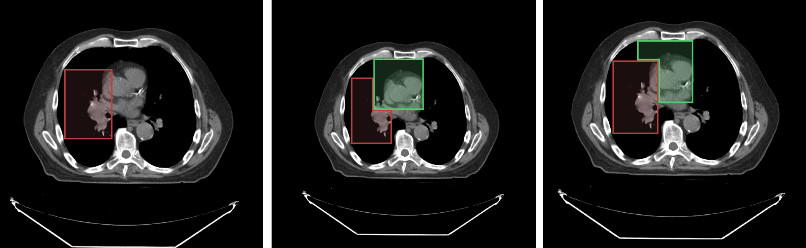

# Segment Locking



You can lock specific segments in a segmentation to prevent them from being modified by any tools.

For example, consider the following image with an overlaid labelmap:

- Left image: shows `segment index 1`
- Middle image: shows the result when `segment index 2` is drawn on top of `segment index 1`
- Right image: shows the result when `segment index 1` is locked and `segment index 2` is drawn on top of `segment index 1`

As shown in the locked scenario (right image), when segment index 1 is locked, it cannot be modified by new drawings.

![segment-locking-example]

## API

The locking API has been updated in version 2.x to provide clearer method names and functionality:

```js
import { segmentation } from '@cornerstonejs/tools';

// Lock/unlock a segment index in a segmentation
segmentation.locking.setSegmentIndexLocked(
  segmentationId,
  segmentIndex,
  locked
);

// Get all locked segment indices for a segmentation
const lockedIndices =
  segmentation.locking.getLockedSegmentIndices(segmentationId);

// Check if a segment index is locked
const isLocked = segmentation.locking.isSegmentIndexLocked(
  segmentationId,
  segmentIndex
);
```

### Example Usage

```js
// Lock segment 1 in a segmentation
segmentation.locking.setSegmentIndexLocked('segmentation1', 1, true);

// Check if segment 1 is locked
const isLocked = segmentation.locking.isSegmentIndexLocked('segmentation1', 1);
console.log(`Segment 1 is ${isLocked ? 'locked' : 'unlocked'}`);

// Get all locked segments
const lockedIndices =
  segmentation.locking.getLockedSegmentIndices('segmentation1');
console.log('Locked segment indices:', lockedIndices);

// Unlock segment 1
segmentation.locking.setSegmentIndexLocked('segmentation1', 1, false);
```

### Key Changes in Version 2.x

1. Renamed `getLockedSegments` to `getLockedSegmentIndices` for clarity
2. The locked state is now stored in the segment data structure:

```js
{
  segments: {
    [segmentIndex]: {
      locked: boolean,
      // other segment properties...
    }
  }
}
```

Note that the locking state applies to the segmentation as a whole, not to specific representations or viewports. If a segment is locked, it will be locked across all viewports and representations.

## Locked segments stop the brush

The brush, the threshold brush and the scissors do not change the voxels of a
locked segment, on any layer of the segmentation. The painted segment stops at
the edge of the locked segment, and a locked segment never causes a new
labelmap layer.

## Protected segments and overlap

The `overwriteMode` setting of the segmentation configuration protects the
segments that the brush does not overwrite:

| `overwriteMode`   | Segments that the brush overwrites | Protected segments          |
| ----------------- | ---------------------------------- | --------------------------- |
| `'all'` (default) | all unlocked segments              | none                        |
| `'visible'`       | visible unlocked segments          | hidden segments             |
| `'none'`          | none                               | all other unlocked segments |

```js
import { init } from '@cornerstonejs/tools';

init({
  segmentation: { overwriteMode: 'none' },
});
```

When a stroke would overwrite a protected segment that is not locked, the brush
moves the painted segment to a new labelmap layer, and the two segments overlap.
The protected segment keeps its voxels. The move and the stroke are one undo
step.

## Overlapping segments

Two segments can overlap only when they are on different labelmap layers. To put
a segment on a layer of its own before a stroke, call
`segmentation.helpers.moveSegmentToPrivateLabelmap`:

```js
import { segmentation } from '@cornerstonejs/tools';

const labelmapId = segmentation.helpers.moveSegmentToPrivateLabelmap(
  segmentationId,
  segmentIndex,
  { recordHistory: true }
);
```

- The function moves the voxels and the binding of the segment to a new layer,
  and returns the id of that layer.
- If the segment is already the only segment on its layer, the segment stays on
  that layer.
- With `recordHistory: true`, the move is one undo step. Undo puts the segment
  back on its previous layer.
- The function triggers `SEGMENTATION_DATA_MODIFIED`.

After the move, a stroke of that segment can paint over the other segments,
unless they are locked. Use `overwriteMode: 'none'` to keep the voxels of the
other segments under the overlap. The brush uses the same move when a stroke
would overwrite a protected segment.
