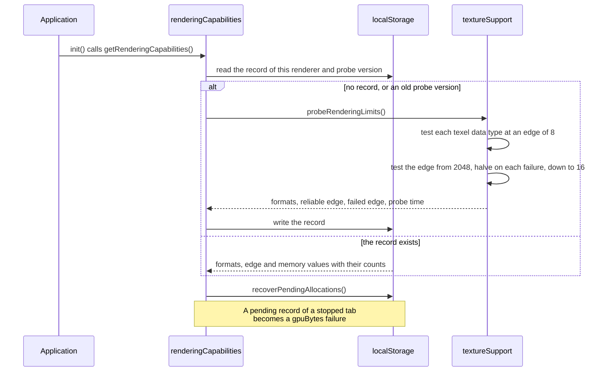
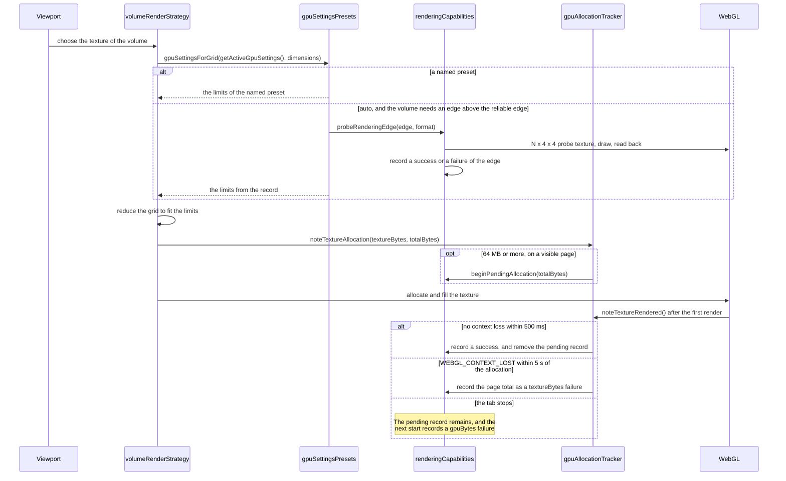
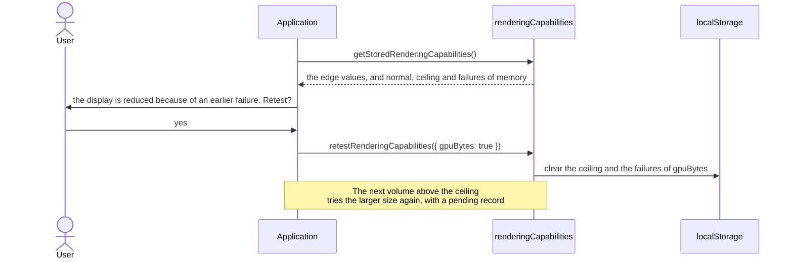

# GPU device limits

## Scope

A viewer runs on devices with very different GPUs. One volume can render on a
desktop GPU and show a uniform gray on a tablet. This specification states what
the user can expect from the display of a volume on any device, and how
Cornerstone3D finds the limits of the device.

The requirements apply when the application turns on final downsampling
(`rendering.lossyDownsampling.final`). Final downsampling is off by default,
because a reduced image is lossy. With final downsampling off, a volume gets a
full-resolution texture, and no preset applies.

The "user" of the user requirements is the person who reads the images in a
viewer. The implementation requirements are for the developer who builds an
application on Cornerstone3D, or who changes the render path.

Change rule:

- A user requirement changes in two cases only: the requirement describes the
  behaviour wrongly, or the intended user-facing behaviour itself changes. An
  implementation that is inconvenient is never a reason to change a user
  requirement.
- An implementation requirement changes freely when a better approach appears.

Related documents:

- The design and its issue:
  [cornerstone3D#3020](https://github.com/cornerstonejs/cornerstone3D/issues/3020).
- The detailed contracts and choices: "How the device limits are found" in
  [Volume Render Strategy](../../concepts/cornerstone-core/volumeRenderStrategy.md),
  `VRS-C-11` to `VRS-C-15` and `VRS-I-12` to `VRS-I-17`.
- The indication of a reduced image:
  [Viewport fidelity](./viewport-fidelity.md).

## Description

A GPU fails in four ways when a viewer asks for too much:

| #   | Cause                                                   | What the user sees                     |
| --- | ------------------------------------------------------- | -------------------------------------- |
| 1   | The edge of a texture is too large for the device.      | A uniform gray or black viewport.      |
| 2   | The texture memory of one WebGL context is too large.   | The viewports go blank (context lost). |
| 3   | The GPU memory of the browser is too large.             | The tab or the browser stops.          |
| 4   | The device claims a texel data type that does not work. | An incorrect image.                    |

A device that reports a limit does not always render up to that limit. Some
devices report a 3D texture edge of 2048, and render a uniform gray above 128.
Thus the reported limits are not sufficient, and the viewer must test the
device.

**Reduced display.** A volume that exceeds the limits of the device shows at a
coarser resolution (a box average of the data). A reduced display is correct,
and the viewport fidelity indicator tells the user that the display is lossy.

## User requirements

### The display adjusts to the device (GPULIMIT-USER)

- **GPULIMIT-USER-1** The user can view a volume on any supported device, and
  the display adjusts to the rendering capability of that device. The user does
  not configure the device.
- **GPULIMIT-USER-2** The viewer detects the capabilities of the local device
  automatically, and chooses a display size that the device can render.
- **GPULIMIT-USER-3** A device that can render a volume within its limits never
  shows that volume as a uniform gray or a uniform black, and never shows an
  incorrect image because of a texel data type.
- **GPULIMIT-USER-4** The viewer does not ask a device to render a data set
  that is too large for that device. The requirement fails when a viewport goes
  blank, the WebGL context is lost, or the tab stops, because the data set
  exceeds the texture memory or the GPU memory of the device.
- **GPULIMIT-USER-5** When the display is reduced, the user can determine that
  the image is lossy (FIDELITY-USER-1 of [Viewport fidelity](./viewport-fidelity.md)).
- **GPULIMIT-USER-6** One failure does not reduce the display permanently. The
  application can offer the user a retest of the failed limits.
- **GPULIMIT-USER-7** A reset of the stored limits makes the next load detect
  the limits of the device from the start.
- **GPULIMIT-USER-8** The detection adds less than 250 ms to the first start of
  a viewer in a new browser. A later start adds no visible delay.

A requirement in this group fails, for example, when a device that can render
within the limits shows all gray or all black, or does not render because the
viewer asked it to render a data set that is too large.

## Implementation requirements

### The preset (GPULIMIT-PROFILE)

- **GPULIMIT-PROFILE-1** The default GPU settings preset is `auto`. An
  application that selects no preset gets `auto` (`VRS-C-11`).
- **GPULIMIT-PROFILE-2** A named preset (`low-tablet`, `low`, `medium`,
  `high`) that the application selects with `setGpuSettingsPreset`
  overrides `auto`. The stored record has no effect on a named preset.
- **GPULIMIT-PROFILE-3** Under `auto`, the edge of a texture is never above an
  edge that a probe passed (`VRS-C-12`, `VRS-I-14`).

### The detection of each failure (GPULIMIT-DETECT)

- **GPULIMIT-DETECT-1** Types 1 and 4: one probe draws N × 4 × 4 3D textures
  and compares texels to the known data (`VRS-I-12`). The probe runs at the
  first start, and again before an allocation that needs an edge above the
  reliable edge. No check after a render detects type 1 (`VRS-I-17`).
- **GPULIMIT-DETECT-2** Type 2: a `WEBGL_CONTEXT_LOST` shortly after a large
  allocation records the GPU bytes of the page as a `textureBytes` failure. A
  loss on a hidden page, or just after a probe, does not count (`VRS-I-15`).
- **GPULIMIT-DETECT-3** Type 3: a pending record in browser storage before a
  large allocation. The first render after the allocation removes the record.
  A record that remains at the next start counts as a `gpuBytes` failure.
- **GPULIMIT-DETECT-4** No probe tests the memory limits, because a probe of
  memory can cause type 2 or type 3.
- **GPULIMIT-DETECT-5** A known gap. No safe probe measures the memory limits
  (GPULIMIT-DETECT-4), so this version does not meet GPULIMIT-USER-4 at a
  memory size that the device has not used before. The first context loss or
  stop of the tab at a new size can occur one time. The reload after it uses a
  lower size (GPULIMIT-MEM-4), and repeated failures cap the size until a
  retest (GPULIMIT-MEM-5). A later version can close this gap with a memory
  value that the browser reports.

### The GPU memory of the page (GPULIMIT-MEM)

- **GPULIMIT-MEM-1** The memory values count the GPU bytes of the viewports of
  this page, from an in-memory ledger (`gpuMemoryLedger`): each texture upload,
  the on-screen canvas of each viewport, the color and depth buffers of each
  WebGL context, and a fixed estimate for each vtk.js context. Another tab does
  not count.
- **GPULIMIT-MEM-2** A texture that moves to another WebGL context counts once,
  because vtk.js releases the upload in the earlier context.
- **GPULIMIT-MEM-3** The `normal` level is the largest page total that worked.
  The `auto` limit is the larger of the start value of the renderer class and
  `normal`.
- **GPULIMIT-MEM-4** For 10 minutes after a failure, the limit is at most half
  of the failed total, so the reload after a failure uses a lower level. A
  success at the failed total ends this earlier.
- **GPULIMIT-MEM-5** Three failures within 7 days set a ceiling at 0.75 of the
  smallest of them, and lower `normal` to the ceiling. One failure does not
  lower the limit of a later session. A success above the ceiling removes it.

### The stored record (GPULIMIT-RECORD)

- **GPULIMIT-RECORD-1** The record is in the `localStorage` key
  `cornerstone3D.renderingCapabilities`. The renderer string and the probe
  version are its key. A missing or failing storage does not stop a render
  (`VRS-C-15`).
- **GPULIMIT-RECORD-2** The edge keeps a reliable value with a count of
  successes, and a failed value with a count of failures. Each memory category
  keeps `normal` with a count of successes, a `ceiling`, the `failures` within
  the window, and the `recent` failure (GPULIMIT-MEM).
- **GPULIMIT-RECORD-3** A write re-reads the stored record and merges the
  change, so two tabs do not lose a recorded failure.

### The retest (GPULIMIT-RETEST)

- **GPULIMIT-RETEST-1** A failed edge and a memory ceiling stay until a retest
  (`VRS-C-13`). `retestRenderingCapabilities()` clears the failures of the
  categories that it names, or of all categories. For memory, it clears the
  ceiling, the failures and the recent failure, and keeps `normal`.
- **GPULIMIT-RETEST-2** `resetRenderingCapabilities({ clearStorage: true })`
  removes the record, so the next load probes from the start.
- **GPULIMIT-RETEST-3** Cornerstone3D shows no prompt. The application reads
  the record with `getStoredRenderingCapabilities()`, and decides when to offer
  a retest (`VRS-C-14`).

## Sequences

### The first start in a browser

### A volume needs a texture

### A retest that the application offers

