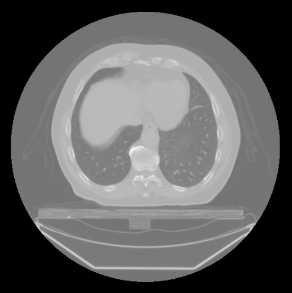

# Render Stack of Images

In this tutorial, you will learn how to render a stack of images.

## Preface

In order to render a set of images we need:

- run initializers for the libraries
- an `element` (HTMLDivElement) to use as the container for the viewport
- the path to the images (`imageId`s).

## Implementation

We have already stored images on a server for the purpose of this tutorial.

1. Initialize the libraries

```js
import { init as coreInit } from '@cornerstonejs/core';
import { init as dicomImageLoaderInit } from '@cornerstonejs/dicom-image-loader';

await coreInit();
await dicomImageLoaderInit();
```

2. Create an HTML element and style it to look like a viewport.
   First let's create an HTML element and style it to look like a viewport.

```js
const content = document.getElementById('content');
const element = document.createElement('div');

element.style.width = '500px';
element.style.height = '500px';

content.appendChild(element);
```

Next, we need a `renderingEngine` and a `viewport` to render the images.

```js
const renderingEngineId = 'myRenderingEngine';
const renderingEngine = new RenderingEngine(renderingEngineId);
```

We can then create a `viewport` inside the renderingEngine by using the `enableElement` API. A planar viewport shows a stack of images or a slice of a volume, so we specify the type of the viewport to be `PLANAR`.

```js
const viewportId = 'CT_AXIAL_STACK';

const viewportInput = {
  viewportId,
  element,
  type: Enums.ViewportType.PLANAR,
};

renderingEngine.enableElement(viewportInput);
```

RenderingEngine will handle creation of the viewports. We register the images once as a display set, under an id that we choose, and then show the display set in the viewport, with the index of the image to be displayed.

:::info
The imageIds that we use here are generated using the `createImageIdsAndCacheMetaData` function.

```js
const imageIds = await createImageIdsAndCacheMetaData({
  StudyInstanceUID:
    '1.3.6.1.4.1.14519.5.2.1.7009.2403.334240657131972136850343327463',
  SeriesInstanceUID:
    '1.3.6.1.4.1.14519.5.2.1.7009.2403.226151125820845824875394858561',
  wadoRsRoot: 'https://d14fa38qiwhyfd.cloudfront.net/dicomweb',
});
```

:::

```js
const viewport = renderingEngine.getViewport(viewportId);
const displaySetId = 'ctStack';

utilities.genericViewportDisplaySetMetadataProvider.add(displaySetId, {
  kind: 'planar',
  imageIds,
  initialImageIdIndex: 60,
});

await viewport.setDisplaySets({ displaySetId });

viewport.render();
```

:::note Tip
Since imageIds is an arrays of imageId, we can set which one to be displayed using
`initialImageIdIndex` of the display set. A display set without a `volumeId` shows
as a stack.
:::

## Final code

<details>
<summary>Final code</summary>

```js
import {
  RenderingEngine,
  Enums,
  utilities,
  init as coreInit,
} from '@cornerstonejs/core';
import { init as dicomImageLoaderInit } from '@cornerstonejs/dicom-image-loader';
import { createImageIdsAndCacheMetaData } from '../../../../utils/demo/helpers';

const content = document.getElementById('content');
const element = document.createElement('div');

element.style.width = '500px';
element.style.height = '500px';

content.appendChild(element);
// ============================= //

/**
 * Runs the demo
 */
async function run() {
  await coreInit();
  await dicomImageLoaderInit();

  // Get Cornerstone imageIds and fetch metadata into RAM
  const imageIds = await createImageIdsAndCacheMetaData({
    StudyInstanceUID:
      '1.3.6.1.4.1.14519.5.2.1.7009.2403.334240657131972136850343327463',
    SeriesInstanceUID:
      '1.3.6.1.4.1.14519.5.2.1.7009.2403.226151125820845824875394858561',
    wadoRsRoot: 'https://d14fa38qiwhyfd.cloudfront.net/dicomweb',
  });

  const renderingEngineId = 'myRenderingEngine';
  const renderingEngine = new RenderingEngine(renderingEngineId);

  const viewportId = 'CT_AXIAL_STACK';

  const viewportInput = {
    viewportId,
    element,
    type: Enums.ViewportType.PLANAR,
  };

  renderingEngine.enableElement(viewportInput);

  const viewport = renderingEngine.getViewport(viewportId);
  const displaySetId = 'ctStack';

  utilities.genericViewportDisplaySetMetadataProvider.add(displaySetId, {
    kind: 'planar',
    imageIds,
    initialImageIdIndex: 60,
  });

  await viewport.setDisplaySets({ displaySetId });

  viewport.render();
}

run();
```

</details>

You should see the following:



## Read more

Learn more about:

- [imageId](../concepts/cornerstone-core/imageId.md)
- [rendering engine](../concepts/cornerstone-core/renderingEngine.md)
- [viewport](../concepts/cornerstone-core/viewports.md)

For advanced usage of a planar viewport that shows a stack, please visit the <a href="https://www.cornerstonejs.org/live-examples/stackapi" target="_blank">Stack API</a> example page.

:::note Tip

- Visit [Examples](../examples.md) page to see how to run the examples locally.

:::
